# Aether

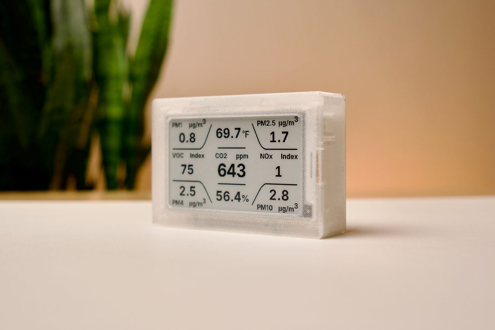

### Aether is a comprehensive air quality monitor by [**Syntropy Labs**](https://syntropylabs.io/products/aether-air-quality-monitor) built around an ESP32-C3, a Sensirion SEN66 sensor, and a 3.7" e-paper display. It measures **CO2, Temperature, Humidity, PM1.0, PM2.5, PM4.0, PM10, VOC index, and NOx index**, and exposes those readings on-device, on the local network, and through Home Assistant.

## Repo Guide

| Path                      | Contents                                                                   |
| ------------------------- | -------------------------------------------------------------------------- |
| `firmware/`               | ESPHome configuration, custom components, web UI sources, and display code |
| `hardware/pcb/`           | KiCad PCB project                                                          |
| `hardware/manufacturing/` | PCB manufacturing outputs, BOM, and centroid files                         |
| `hardware/datasheets/`    | Reference datasheets used during hardware design                           |
| `enclosure/`              | SolidWorks enclosure and assembly files                                    |
| `manifests/`                  | Firmware manifests for OTA and WebUSB                      |
| `www/`                        | The combined WebUSB flasher and Quick Start Guide site     |

## Contents

- [Features](#features)
- [Hardware](#hardware)
- [Assembly](#assembly)
- [Firmware Setup](#firmware-setup)
  - [Flashing firmware onto a device](#flashing-firmware-onto-a-device)
  - [Firmware development](#firmware-development)
- [Using Aether](#using-aether)
  - [Normal operation](#normal-operation)
  - [Wi-Fi setup and behavior](#wi-fi-setup-and-behavior)
  - [Side button behavior](#side-button-behavior)
  - [Local web UI](#local-web-ui)
  - [Apple HomeKit](#apple-homekit)
  - [Home Assistant & ESPHome API](#home-assistant--esphome-api)
  - [Updates](#updates)
- [License](#license)

## Features

- Measures CO2, Temperature, Humidity, PM1.0, PM2.5, PM4.0, PM10, VOC index, and NOx index using the **Sensirion SEN66**
- Displays live readings on a **416x240 3.7" e-paper panel**
- Serves a **local web dashboard** from the device itself
- Pairs natively with **Apple HomeKit** — no hub, bridge, or Home Assistant required
- Supports **ESPHome / Home Assistant** integration
- Supports **USB factory flashing**, **firmware recovery**, and **OTA updates**
- Fully local, and can run **with or without Wi-Fi**

## Hardware

To build one Aether unit, the following core parts are needed:

| Part                                       | Link                                                                                                                                                                                                                                          |
| ------------------------------------------ | --------------------------------------------------------------------------------------------------------------------------------------------------------------------------------------------------------------------------------------------- |
| **Aether PCB**                             | [Syntropy Labs Store](https://syntropylabs.io/products/aether-air-quality-monitor-custom-pcb) (PCB files available in [`hardware/`](https://github.com/EnriqueNeyra/aether/tree/main/hardware/manufacturing) folder)                          |
| **3.7" e-paper display module**            | [Good Display](https://buy-lcd.com/products/37-inch-416x240-e-paper-black-and-white-spi-fast-refresh-electronic-eink-display-screen-esl-gdey037t03?VariantsId=10346) / [Elecrow](https://www.elecrow.com/3-7-inch-240-416-e-paper-display-black-white-e-ink-display-with-spi-communication.html?srsltid=AfmBOorEN78tDAbaNR6usiU2un_OspDES5jOZ0fWlxrPbxKdn6s-n3yS) |
| **Sensirion SEN66** air quality sensor     | [Sensirion](https://sensirion.com/products/catalog/SEN66) |
| **Reverse 6-pin JST-GH cable**             | [Adafruit](https://www.adafruit.com/product/5754?srsltid=AfmBOopcC6siE6KqjNqU-nj7AwIrnvlDSqnL19iwFrZ47O6lRIhqRYC8) / [AliExpress](https://www.aliexpress.us/w/wholesale-jst-gh-1.25mm-connector-6-pin-reverse.html?spm=a2g0o.detail.search.0) |
| **3D-printed enclosure parts**             | [`enclosure/`](https://github.com/EnriqueNeyra/aether/tree/main/enclosure) |
| **2x M3 x 6 mm countersunk screws + nuts** | [Screws](https://amzn.to/3SKvOgg) / [Nuts](https://amzn.to/44jUIG1) |

<sub>As an Amazon Associate I earn from qualifying purchases.</sub>

<p align="center">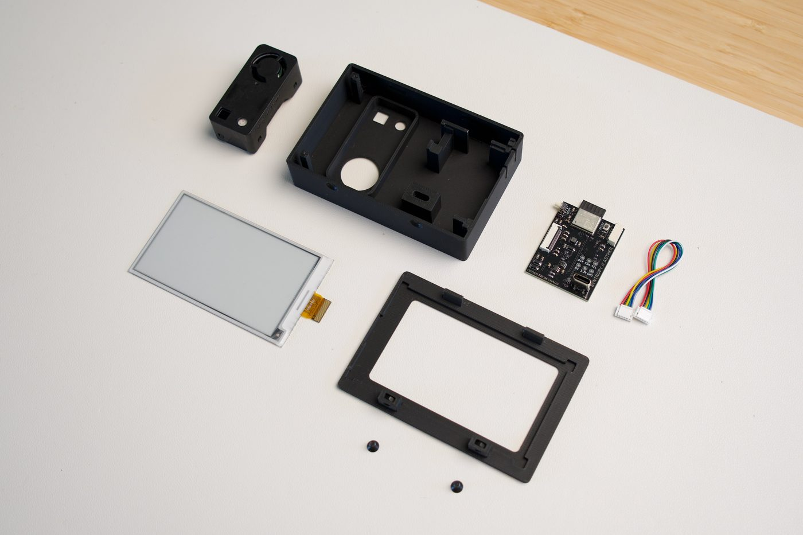</p>

### Alternative Display Compatibility

The Aether PCB implements the standard 24-pin FPC e-paper interface. While designed for the 3.7" GDEY037T03, it is hardware-compatible with many other common e-paper panels (e.g., those using SSD1680, UC8151D, and IL0373 driver ICs). **Please note that these alternative displays have not yet been tested or confirmed to work with this device.**

If you choose to use an alternative display, you will need to:
1. **Update the firmware** to instantiate the correct `GxEPD2` display driver class.
2. **Modify the enclosure design** to physically fit the new panel dimensions.

For specific supported ICs and detailed firmware instructions, see [display-compatibility.md](display-compatibility.md).

## Assembly

High-level assembly flow:

### 1. Press-fit the SEN66 into the enclosure body.

<p align="center">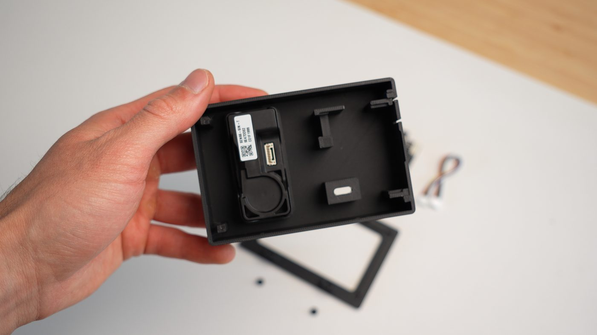</p>

### 2. Connect the e-paper display to the PCB with the FPC connector.

<p align="center">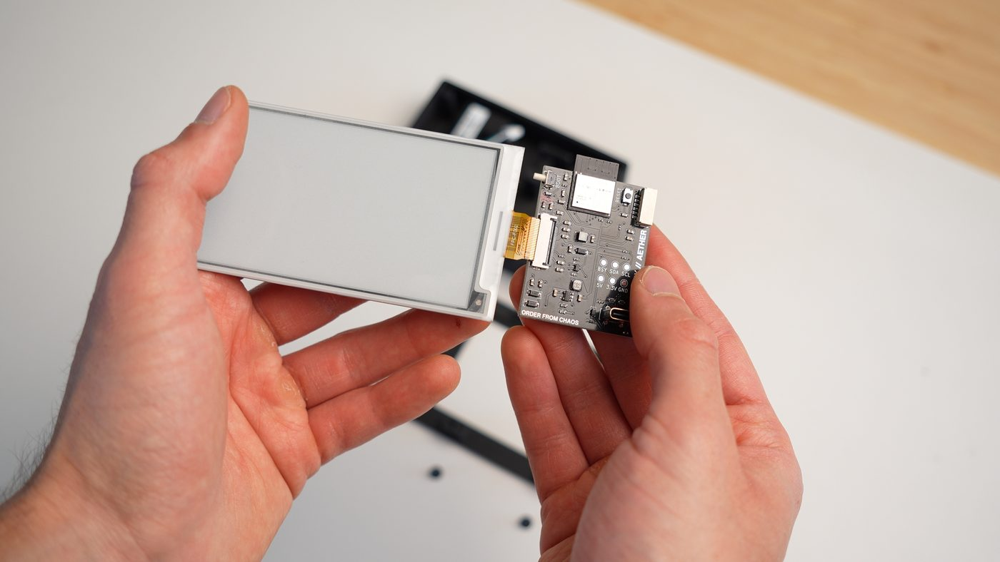</p>

### 3. Press-fit the PCB into the enclosure body.

<p align="center">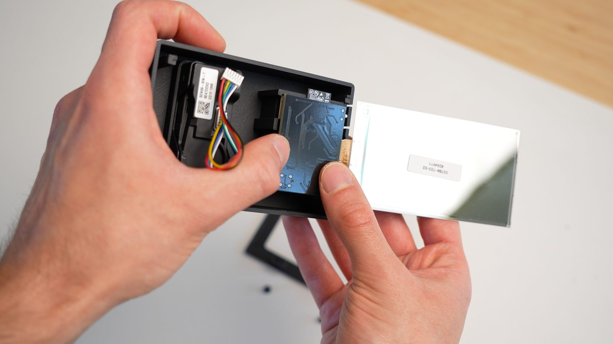</p>

### 4. Connect 6-pin JST GH Cable.

<p align="center">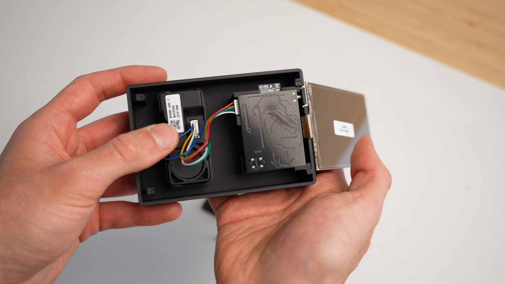</p>

### 5. Bring display over in position above the PCB.

<p align="center">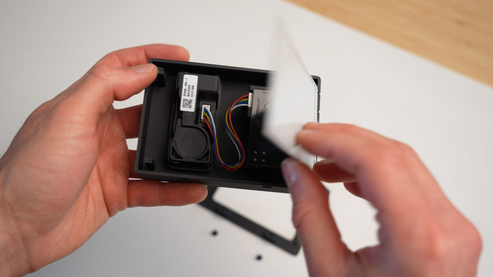</p>
<p align="center">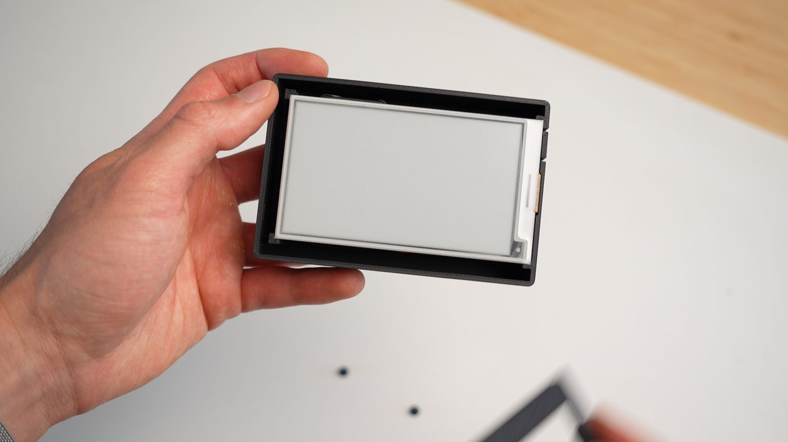</p>

### 6. Attach the display cover.

<p align="center">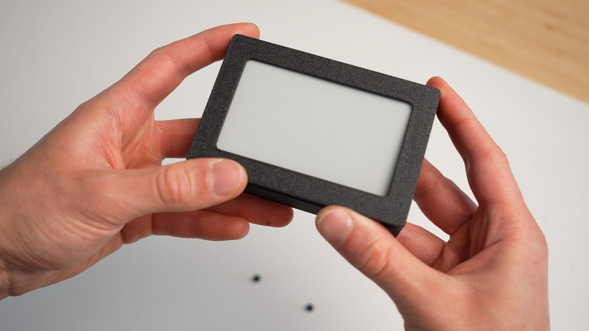</p>

### 7. Secure the assembly from the bottom with the two M3 fasteners.

<p align="center">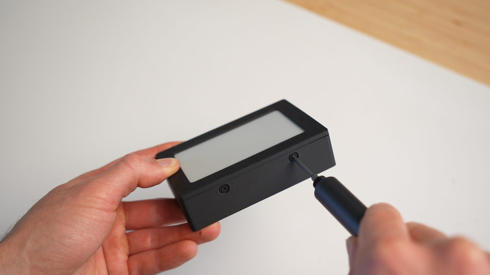</p>

## Firmware Setup
_Any Aether devices purchased through [**Syntropy Labs**](https://syntropylabs.io/) are pre-flashed with device firmware and fully tested_

### Flashing firmware onto a device

#### For a new board or a device that needs recovery:

1. Connect Aether to your computer over USB.
2. Open the [Aether WebUSB flashing tool](https://aether.syntropylabs.io/) and go to **Firmware & Updates**.
3. Click **Install Aether firmware** under **Install or Update over USB**.
4. Keep the page open until flashing is complete.
5. Let the device boot.

#### For a device that is already set up and just needs newer firmware:

- **Over Wi-Fi (recommended):** open the device's [local web UI](#local-web-ui), go to **Firmware & updates**, and click **Update**. Home Assistant offers the same update.
- **Over USB:** follow the steps above. When the connected device is already running Aether firmware, the flasher offers an **update** that keeps your Wi-Fi and settings instead of erasing the device.

_Note: The flashing page in `www/` is built around **ESP Web Tools / Web Serial** and requires desktop **Chrome or Edge**._

#### Upgrading to the first HomeKit release from 1.0.13 or earlier

The HomeKit firmware uses a **larger partition table** to make room for the HAP stack, and a partition table cannot be changed over the air. Upgrading from 1.0.13 or earlier therefore requires **one USB factory flash**:

1. Connect Aether over USB and open the [flashing tool](https://aether.syntropylabs.io/).
2. Choose **Factory flash**, not the OTA option.
3. Re-run Wi-Fi setup through the captive portal afterwards, since a factory flash clears stored settings.

Every release *after* that one updates over the air as usual.

#### Building and flashing it yourself

If you would rather build from source and flash over USB:

```sh
git clone https://github.com/EnriqueNeyra/aether.git
cd aether/firmware

# Matches the version range used in .github/workflows/release.yml
pip install "esphome>=2026.8.1"

# Plug Aether in over USB, then:
esphome run aether.yaml
```

Pick the USB serial port when prompted. The first build downloads the ESP32 toolchain and takes a while; later builds are much faster.

To produce the same artifacts CI publishes, without flashing:

```sh
esphome compile aether.yaml
# firmware.factory.bin / firmware.ota.bin land in
# firmware/.esphome/build/aether/.pioenvs/aether/
```

### Firmware development

If you are working on the ESPHome firmware, use the **latest ESPHome release**. Releases are built with it, and CI checks every PR against it. The default PlatformIO toolchain needs Python 3.12–3.14:

```sh
pip install --upgrade esphome
git clone https://github.com/EnriqueNeyra/aether.git
cd aether/firmware
```

```sh
esphome config aether.yaml
esphome compile aether.yaml
esphome run aether.yaml
```

Release firmware can't be flashed over Wi-Fi. To iterate over Wi-Fi, flash `aether-dev.yaml` over USB once, then use `esphome run aether-dev.yaml --device <device-ip>`.

To try ESPHome's native ESP-IDF toolchain (the default once `toolchain: platformio` is removed in ESPHome 2027.2.0), pass `-s toolchain esp-idf`, e.g. `esphome -s toolchain esp-idf compile aether.yaml`.

## Using Aether

### Normal operation

Once powered, Aether reads the SEN66 and refreshes both the on-device display and the local web dashboard. Temperature can be shown in either **Fahrenheit** or **Celsius**.

### Wi-Fi setup and behavior

On boot, Aether will expose a temporary setup access point so you can connect it to Wi-Fi through the captive portal flow. The network will appear as **aether-XXXXXX**. 

<p align="center">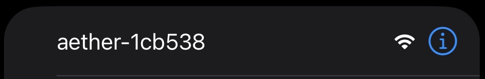</p> 

- If you want **local web UI access**, **network-based ota updates**, or **Home Assistant integration**, connect the device to Wi-Fi during setup.
- If you do **not** configure Wi-Fi, the device will still work as a standalone monitor **fully offline**.

Once connected to the access point, you will automatically be redirected to the captive portal. Select your network and enter the password to connect. Once connected to Wi-Fi, the device also hosts its [local web UI](#local-web-ui) at **aether-XXXXXX.local** or the **device's local IP**.

### Side button behavior

The side / boot button supports multiple actions:

- **Short press (tap, under 1 second):** cycles normal dashboard → info screen → HomeKit setup screen → normal dashboard
- **Long press (hold ~3 seconds) from the normal screen:** enters factory reset confirmation
- **Long press (hold ~3 seconds) again on the reset screen:** confirms the factory reset flow
- **Long press (hold ~3 seconds) on the info screen while Wi-Fi is not connected:** reboots the device, which brings the setup access point back after offline mode

The info and HomeKit screens ignore long presses, so you cannot fall into the reset flow from them by accident.

### Local web UI

When Aether is on your network, it serves a local browser-based dashboard directly from the device. That UI includes:

- A live environment view for sensor readings
- Temperature unit switching
- Firmware version and update status
- A way to trigger firmware updates from the device UI

### Apple HomeKit

Aether speaks the HomeKit Accessory Protocol directly over Wi-Fi. It pairs with the Home app on its own — there is **no bridge, no hub, and no Home Assistant** in the path.

#### Pairing

1. Make sure Aether is connected to the same Wi-Fi network as your iPhone, iPad, or Mac.
2. Press the side button twice to reach the **HomeKit Setup** screen (Normal → Device Information → HomeKit Setup).
3. In the Home app, tap **+** → **Add Accessory** and scan the QR code on Aether's screen.
4. If you would rather type the code, tap **More options…**, pick **Aether**, and enter the setup code shown on the screen and in the local web UI's **HomeKit** tab.

The default setup code is **466-37-726**. To ship devices with unique codes, change `pairing_code` under `aether_homekit:` in `firmware/aether.yaml` and rebuild. The code is applied on first boot after a change, which takes a few seconds of SRP key generation; afterwards it is read from NVS.

#### What appears in the Home app

Aether pairs as a **HomeKit bridge** that publishes four separate accessories:

| Home app tile | HAP characteristics | Source |
| ------------- | ------------------- | ------ |
| Aether Temperature | `CurrentTemperature` | SEN66 temperature |
| Aether Humidity | `CurrentRelativeHumidity` | SEN66 humidity |
| Aether CO2 | `CarbonDioxideLevel`, `CarbonDioxideDetected` | SEN66 CO2 (alert above 1000 ppm) |
| Aether Air Quality | `AirQuality`, `PM25Density`, `PM10Density`, `VOCDensity`, `NitrogenDioxideDensity` | PM2.5, PM10, VOC Index, NOx Index |

They are published as separate accessories rather than as one accessory with four services on purpose. The Home app collapses a multi-service accessory into a **single tile**, which shows only the highest-priority state — in practice just the red "Carbon Dioxide Detected" alert, with every numeric reading hidden a couple of taps away. As four accessories, each gets its own tile showing its current value.

Because these are real HomeKit sensors, they also work in Home **widgets** on iOS and macOS (add the *Home* widget and pick the Aether sensors you want), in Siri queries, and as triggers in Home automations.

Rename any of them in the Home app if you prefer shorter names — the names above are only the defaults.

#### Two caveats worth knowing

- **PM1.0 and PM4.0 are not exposed.** HAP simply defines no characteristic for them. They remain available on the e-paper display, in the local web UI, and over the ESPHome API.
- **VOC Index and NOx Index are unitless 1–500 scales**, but the only numeric slots HAP offers are `VOCDensity` and `NitrogenDioxideDensity`. The Home app will therefore label them as densities in µg/m³. The number is the Sensirion index, not a concentration.

The overall **Air Quality** rating (Excellent → Poor) is computed on-device from the worst of PM2.5, VOC Index, and CO2.

#### HomeKit and Home Assistant together

Both run at the same time. The ESPHome API, the local web UI, and HomeKit are independent, so pairing with Apple Home does not affect any existing Home Assistant setup.

#### What HomeKit cost

The ESP32-C3 has only 4 MB of flash, and the stock firmware already used 95.8% of its app partition. Making room meant two changes:

- The partition table was enlarged, reclaiming 384 KB the stock layout left unallocated. This is why upgrading from 1.0.13 needs [one USB factory flash](#upgrading-to-the-first-homekit-release-from-1013-or-earlier).
- **Bluetooth Wi-Fi provisioning (`esp32_improv`) was removed.** Its Bluetooth stack cost ~432 KB, more than HomeKit itself. Wi-Fi setup is unchanged in practice: the USB flashing page still provisions over USB, and the captive-portal access point still works. Only the Bluetooth path is gone.

The result is 87.9% of the enlarged app partition, with room to spare.

### Home Assistant & ESPHome API

Because Aether runs ESPHome, it features a native API over Wi-Fi. This allows for:

- **Automatic Home Assistant Integration:** Aether will automatically appear in Home Assistant integrations dashboard once connected to your network. It exposes all 9 sensor metrics (CO2, temperature, humidity, PM1.0, PM2.5, PM4.0, PM10, VOC index, and NOx index).

<p align="center">
  <a href="https://my.home-assistant.io/redirect/integrations/">
    
  </a>
</p>

- **Custom Integrations:** You can integrate Aether into your own software or scripts using its local HTTP API. Exposed endpoints include:
  - `GET /api/state` - Returns a JSON object with all current sensor metrics and device status.
  - `POST /api/temp_unit?unit=C|F` - Changes the preferred temperature unit.
  - `POST /api/check_update` - Asks the device to re-check for a firmware update now.
  - `POST /api/perform_update` - Triggers the device to immediately begin downloading and installing the latest firmware update over HTTPS (if one is available).

### Updates

Aether supports more than one update path:

- **Local USB flashing** through the [WebUSB flashing tool](https://aether.syntropylabs.io/) (source located in `www/`)
- **In-device update flow** through the local web UI
- **Home Assistant** when the device is online

Use the USB flashing page for first-time setup and recovery. Use the local web UI for routine updates on devices that are already deployed.

## License

Aether is licensed per directory:

- **Firmware** (`firmware/`): [GNU General Public License v3](firmware/LICENSE). The firmware is built on GPLv3 code (ESPHome's C++ runtime and the GxEPD2 display driver), so it and the firmware binaries built from it are distributed under GPLv3.
- **Everything else** (hardware, PCB and manufacturing files, enclosure, website, and documentation): [Creative Commons Attribution-NonCommercial-ShareAlike 4.0 International License](http://creativecommons.org/licenses/by-nc-sa/4.0/). See [LICENSE](LICENSE).

Third-party components keep their own licenses, including the fonts in `firmware/components/aether_epaper/fonts/` and the libraries the firmware is built with.

[](http://creativecommons.org/licenses/by-nc-sa/4.0/)
